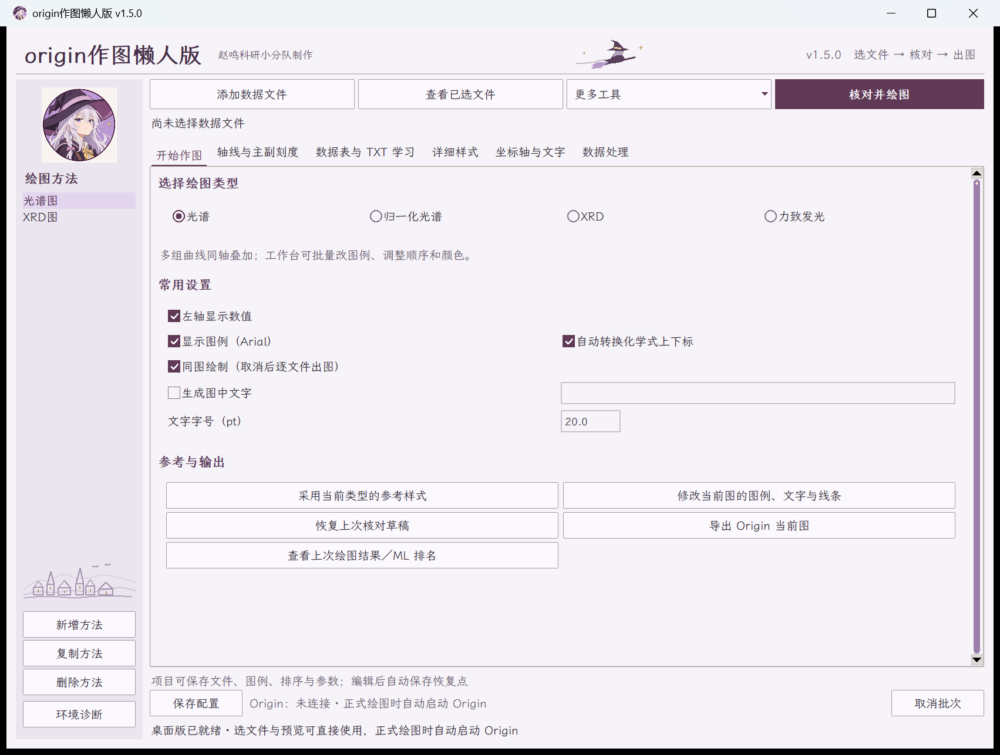

# LazzyOriginPlot · origin作图懒人版

在 Origin 里把实验文件整理成可编辑的科研图。选数据、核对每条曲线、用保存的绘图方法出图。

[下载 Origin 插件](https://github.com/djydhh/LazzyOriginPlot/releases/latest) · [报告问题](https://github.com/djydhh/LazzyOriginPlot/issues/new)

## 安装与第一次绘图

1. Windows 上使用 **OriginPro 2024**。插件的独立界面还需要 **Python 3.10 或以上**，安装时保留 Tkinter。
2. 从 Releases 下载 `OriginPlotLearner-*.opx`，拖到 Origin 主窗口并按提示安装，然后从 **Apps** 面板打开插件。
3. 选择绘图类型，点击 **添加数据文件** 选择一批或多批 TXT。点击 **核对并绘图**，确认读取规则、XY、图例和顺序后出图。

## 支持的绘图

| 模式 | 能做什么 |
| --- | --- |
| 光谱 | 同图叠加多组曲线，支持分别设置图例、颜色和顺序。 |
| 归一化光谱 | 每组默认按最大 Y 归一化，也可为每条曲线指定基准 X。 |
| XRD | 区分实验曲线和标准卡片棒线，在同图中排布，支持调整图层顺序。 |
| 力致发光 | 在候选数据中比较峰值并绘制最高的一组。 |

可以学习参考 Origin 图的样式和仪器 TXT 的读取规则，保存成可复用的方法。工作台支持预览、调整读取列和撤销。绘图完成后可从 Origin 导出 PNG、TIFF 或 PDF。

## 获取更新

插件启动时检查最新 Release，也可在 **更多工具 → 检查插件更新** 中手动检查。发现新版后确认下载，插件会校验安装包，再提示通过 Origin 安装。v1.4.6 和更早版本的用户先手动安装一次新版。

遇到识别或绘图问题时，可在 Issue 中注明插件版本、Origin 版本、绘图模式、复现步骤和报错文字。如需提供示例数据，请使用可公开的样本。

赵鸣科研小分队制作
